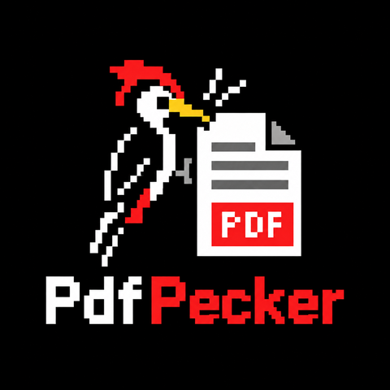

# PdfPecker

[](https://www.nuget.org/packages/PdfPecker)

Fast HTML and Markdown to PDF conversion, PDF to PNG, JPEG, WebP and TIFF rendering, and PDF to HTML and Markdown, for
.NET, with no dependencies.

PdfPecker has its own HTML parser, Markdown parser, CSS engine, layout engine and PDF writer, and its own PDF renderer.
It does not start a browser, ship native binaries or pull in third-party packages; the NuGet package depends only on
the .NET base class library.

```csharp
using PdfPecker;

byte[] pdf = HtmlToPdf.Convert("<h1>Hello</h1><p>World</p>");
File.WriteAllBytes("hello.pdf", pdf);
```

**Documentation: [pdfpecker.net/docs](https://pdfpecker.net/docs/)** · [HTML to PDF in C#: a step-by-step guide](https://pdfpecker.net/docs/html-to-pdf-csharp/)

## Install

```
dotnet add package PdfPecker
```

The package targets `net8.0`, `net9.0` and `net10.0`, so it works on .NET 8 and later, on Windows, Linux and macOS.

## Quick start

```csharp
// HTML string to PDF bytes, or file to file (relative images and stylesheets resolve against the HTML file's folder)
byte[] pdf = HtmlToPdf.Convert(html);
HtmlToPdf.ConvertFile("invoice.html", "invoice.pdf");

// ASP.NET Core
app.MapGet("/invoice", () => Results.File(HtmlToPdf.Convert(html), "application/pdf", "invoice.pdf"));

// Page size, margins, footer and fonts
var options = new PdfOptions
{
    PageSize = PageSize.Letter,
    Margins = PageMargins.FromMillimeters(20, 15, 20, 15),
    FooterText = "Page {page} of {pages}",
};
options.Fonts.AddFile("fonts/OpenSans-Regular.ttf");
byte[] letter = HtmlToPdf.Convert(html, options);

// A copy of shared options with one setting changed, leaving the shared ones as they are
var draft = options.Clone();
draft.HeaderText = "Draft";
byte[] draftLetter = HtmlToPdf.Convert(html, draft);

// Markdown to PDF or HTML, merging, PDF pages to PNG, and a whole PDF to one black and white fax TIFF
byte[] guide = MarkdownToPdf.Convert(File.ReadAllText("README.md"));
string guideHtml = MarkdownToHtml.Convert(File.ReadAllText("README.md"));
byte[] merged = PdfMerger.Merge(invoicePdf, termsPdf);
byte[][] pngs = PdfToImage.Convert(pdf, new ImageOptions { Dpi = 150 });
byte[] tiff = PdfToImage.ConvertToTiff(pdf, new ImageOptions { Dpi = 200, TiffColorMode = TiffColorMode.BlackAndWhite });

// Make any existing PDF smaller: losslessly, or with images downsampled to 150 dpi and recompressed as JPEG
byte[] smaller = PdfCompactor.Compact(File.ReadAllBytes("scan.pdf"));
byte[] smallest = PdfCompactor.Compact(pdf, new PdfCompactOptions { MaxImageDpi = 150, ImageQuality = 75 });

// Strip JavaScript, launch and submit actions and other active content from a PDF someone sent you
byte[] safe = PdfSanitizer.RemoveActiveContent(File.ReadAllBytes("received.pdf"));

// Turn any existing PDF into PDF/A-2b for archiving, with a list of what changed and of anything left to fix
var archived = PdfToPdfA.Convert(File.ReadAllBytes("received.pdf"));
if (!archived.IsConformant) Console.WriteLine(string.Join("\n", archived.Problems));

// Fast Web View: the first page shows while the rest of a large PDF is still downloading
byte[] web = HtmlToPdf.Convert(html, new PdfOptions { Linearize = true });
byte[] mergedForWeb = PdfLinearizer.Linearize(PdfMerger.Merge(invoicePdf, termsPdf));
byte[] protectedForWeb = PdfLinearizer.Linearize(mergedForWeb, new PdfSecurity { UserPassword = "secret" }, password: null);

// Title, author, PDF version, page sizes, encryption and PDF/A claim of any PDF
var properties = PdfDocumentProperties.Read(File.ReadAllBytes("received.pdf"));
Console.WriteLine($"{properties.Title} by {properties.Author}: PDF {properties.Version}, {properties.PageCount} pages, {properties.PdfAConformance}");

// Any PDF as one self-contained HTML page: page images with selectable, searchable text and working links
string html = PdfToHtml.Convert(File.ReadAllBytes("statement.pdf"));

// Or its text as headings, paragraphs, lists and real <table> elements in reading order, for search and language models
string structured = PdfToHtml.Convert(File.ReadAllBytes("statement.pdf"), new PdfHtmlOptions { Mode = PdfHtmlMode.Structured });

// The same structure with the PDF's fonts, colours, backgrounds, borders and pictures
string styled = PdfToHtml.Convert(File.ReadAllBytes("statement.pdf"),
    new PdfHtmlOptions { Mode = PdfHtmlMode.Structured, IncludeStyles = true, IncludeImages = true });

// Or as Markdown: headings, lists, bold and italic, links and pipe tables, for language models and search indexes
string markdown = PdfToMarkdown.Convert(File.ReadAllBytes("statement.pdf"), new PdfMarkdownOptions { IncludePageComments = true });

// Open a PDF once and render its pages one at a time, or in parallel
var renderer = PdfRenderer.Open(pdf);
renderer.RenderPage(0, new ImageOptions { Dpi = 150 }).Save("page1.png");
```

The conversion methods are static and thread-safe, so you can convert many documents in parallel. The few instance types are `FontCollection` and `PdfRenderer`, which can be shared by parallel work, and `StreamingPdfMerger`, which is not thread-safe: it builds one output and is used from one thread at a time.

## Fluent API

[PdfPecker.Fluent](https://www.nuget.org/packages/PdfPecker.Fluent) builds the same PDFs from C# code instead of HTML,
in the style of QuestPDF, so most QuestPDF documents port by changing the `using` lines. It is a separate package from
this repository, released with every PdfPecker release under the same version, and its only dependency is PdfPecker.

```
dotnet add package PdfPecker.Fluent
```

```csharp
using PdfPecker.Fluent;

Document.Create(container => container.Page(page =>
{
    page.Size(PageSizes.A4);
    page.Margin(2, Unit.Centimetre);
    page.Header().Text("Invoice 2026-104").FontSize(20).Bold();
    page.Content().Table(table =>
    {
        table.ColumnsDefinition(columns => { columns.RelativeColumn(3); columns.RelativeColumn(); });
        table.Cell().Text("Consulting");
        table.Cell().AlignRight().Text("1,200.00");
    });
    page.Footer().AlignCenter().Text(x => { x.CurrentPageNumber(); x.Span(" / "); x.TotalPages(); });
}))
.GeneratePdf("invoice.pdf");
```

It writes compact HTML and CSS and renders it with PdfPecker, so every `PdfOptions` feature (PDF/A, PDF/UA,
signatures, e-invoices) works with it. Its `DocumentOperation` takes QuestPDF's calls for existing PDFs (choosing and
merging pages, overlays and underlays, attachments, encryption, linearization) and runs them on PdfPecker's merger,
stamper and protector. What it covers and how it differs from QuestPDF is in its
[README](https://github.com/Moonwalker1307/PdfPecker/blob/main/src/PdfPecker.Fluent/README.md).

## Command line

[PdfPecker.Cli](https://www.nuget.org/packages/PdfPecker.Cli) is the same library as a `pdfpecker` command, for scripts,
build pipelines and designing a template. It is a dotnet tool released with every PdfPecker release under the same
version, and like the library it needs no browser, no JavaScript and no network.

```
dotnet tool install -g PdfPecker.Cli

pdfpecker convert invoice.html                       # writes invoice.pdf; .md files are Markdown
pdfpecker watch invoice.html                         # converts again on every save, for a live preview in your PDF viewer
pdfpecker merge cover.pdf report.pdf:2-9 -o all.pdf  # also split, extract, remove, rotate, stamp, compact, linearize
pdfpecker sign all.pdf signed.pdf --cert me.pfx      # also verify, encrypt, decrypt, sanitize
pdfpecker to-image all.pdf pages --format webp       # also to-html, text, info
```

A call without a command word is read like wkhtmltopdf's, so a script can switch by changing the program name:
`pdfpecker -s A4 -T 15mm --footer-center "[page] / [topage]" in.html out.pdf`. Page size, orientation, margins, headers and
footers with their tokens, zoom, style sheets and quiet mode work as they do there; options that exist because
wkhtmltopdf runs a browser (`--javascript-delay`, `--cookie`, `--header-html`, ...) are ignored with a warning. Web
addresses are refused. Its README is
[here](https://github.com/Moonwalker1307/PdfPecker/blob/main/src/PdfPecker.Cli/README.md).
## Testing PDFs

[PdfPecker.Testing](https://www.nuget.org/packages/PdfPecker.Testing) adds snapshot tests for the PDFs your code makes.
`PdfAssert.MatchesSnapshot` compares a PDF with a stored one, leaving out dates, file IDs and stream compression, and
when they differ it writes the new PDF and page images with the changed pixels marked. It works with any test
framework, because a failed check throws. It is released with every PdfPecker release under the same version, and its
only dependency is PdfPecker.

```
dotnet add package PdfPecker.Testing
```

```csharp
using PdfPecker.Testing;

byte[] pdf = HtmlToPdf.Convert(invoiceHtml);
PdfAssert.MatchesSnapshot(pdf, "invoice");   // Snapshots/invoice.pdf next to the test file
PdfAssert.ContainsText(pdf, "Total due: 1,500.00");
PdfAssert.HasPageCount(pdf, 1);
```

How snapshots are created and accepted, and the appearance comparison for PDFs from other producers, are in its
[README](https://github.com/Moonwalker1307/PdfPecker/blob/main/src/PdfPecker.Testing/README.md).

## Razor components

[PdfPecker.Razor](https://www.nuget.org/packages/PdfPecker.Razor) turns Razor components (`.razor` files) into PDFs,
so a template gets typed parameters, compile-time checks, child components, layouts and dependency injection. It renders
the component to HTML with Microsoft's `HtmlRenderer`, without an ASP.NET Core host, and converts the HTML with
PdfPecker. It is released with every PdfPecker release under the same version, and it is the one package here with a
dependency besides PdfPecker: Microsoft's `Microsoft.AspNetCore.Components.Web`, which holds the renderer.

```
dotnet add package PdfPecker.Razor
```

```csharp
using PdfPecker.Razor;

// Invoice.razor has [Parameter] public InvoiceModel Data { get; set; }
byte[] pdf = await RazorToPdf.ConvertAsync<Invoice>(new Dictionary<string, object?> { ["Data"] = invoice });
```

Razor encodes caller data, every `PdfOptions` setting works, and the package is trimmable and runs with Native AOT
(Microsoft's components assembly reports trim warnings of its own, which its README explains). How to set up the
Razor project, inject services and stream to an ASP.NET Core response is in its
[README](https://github.com/Moonwalker1307/PdfPecker/blob/main/src/PdfPecker.Razor/README.md).

## Features

- **HTML and CSS**: flexbox, grid and subgrid, CSS tables (collapsed borders also from `col` and `colgroup`; rows and
  columns with `visibility: collapse` leave), floats with `shape-outside`, `clip-path` shapes (also `rect()` and
  `xywh()`), sizes that fill the containing block (`width: stretch` and `-webkit-fill-available`, also for heights and
  their limits), `corner-shape` (squircle, bevel, scoop, notch and `superellipse()` corners on borders, backgrounds,
  shadows, outlines and clips), `overflow: clip` with `overflow-clip-margin`, `zoom` (as Chrome
  computes it, for templates that shrink a page to fit), multi-column layout, gap decorations (`column-rule` and
  `row-rule` in grid and flex containers too, with lists and `repeat()`, `rule-break`, `rule-inset`,
  `rule-visibility-items` and `rule-overlap`, cut where a grid or flex container breaks across pages),
  positioning (also the legacy `clip: rect()`, and absolute boxes inside a positioned inline element, such as
  tooltips and badges), transforms, gradients (also `in oklch` and other colour spaces, and as
  list markers), fixed background images (placed on each page's paper, as Chrome prints them), filters, masks,
  media and container queries, `@scope` (scope roots, limits and proximity, as in Chrome), logical properties, `writing-mode` (with floats, sized boxes and vertical-lr line
  order), `text-wrap` and `white-space-collapse`, hanging indents (`text-indent` with `hanging` and `each-line`), emphasis
  marks (`text-emphasis`), trimming lines to the cap height and baseline (`text-box`, for optically centred
  buttons and badges), `line-clamp` with your own `block-ellipsis`, underlines from the font or below the descenders
  (`text-underline-position`), drop caps, `::first-line` styles with a background, `::marker` styles (a larger marker font or a tall marker image makes its
  line taller, `content: none` hides the marker, `counter(list-item)` numbers it and its own `direction` orders its
  text, as in Chrome), images and gradients in `::before` and `::after` content, inline SVG (with
  percentage coordinates and sizes, as in Bootstrap's placeholder images, `cx`, `cy`, `r`, `rx`, `ry`, `x`, `y`, `width`, `height`, `d: path()` and `stop-color` set from style sheets, HTML in `<foreignObject>`, and icons drawn
  with `<use>` from a sprite of symbols that is itself hidden, as in Bootstrap's icon sprites; also CSS `transform` with `transform-box` and
  `transform-origin` on SVG elements, such as a gauge needle turning about its own centre, and `vector-effect: non-scaling-stroke`
  for hairlines in a scaled chart, though markers still scale) and PNG, JPEG, GIF, WebP, BMP and TIFF images (also chosen by `srcset`, `<picture>` and
  `image-set()`,
  shown by `<embed>` and `<object>`, photos turned upright by their EXIF orientation, and `image-rendering: pixelated`
  or `crisp-edges` writing enlarged images, such as QR codes and pixel art, with hard pixel edges in every PDF viewer), and CSS-only charts such as
  Charts.css (column, bar, area, line and pie charts), laid out as Chrome lays them out. Typed `attr()` works in any
  property, as in Chrome: `width: attr(data-pct %)`, `color: attr(data-color type(<color>), gray)` or
  `calc(attr(data-v number) * 1mm)` draw bar charts and badges from data attributes, with fallbacks, `::before` reading
  its element's attributes, and no attribute value ever reaching a `url()`. `sibling-index()` and `sibling-count()`
  work as in Chrome too, for staggered widths, colours that step through a list and tabs that share a row evenly. `if()`
  chooses a value from `style()` of a custom property, `media()` or `supports()`, such as
  `border-color: if(style(--status: overdue): red; else: green)`, as in Chrome (whose `media()` in `if()` still asks
  about the screen when it prints). Older CSS works too: the
  `-webkit-` property names Chrome still takes (`-webkit-transform`, `-webkit-flex`, ...), the legacy
  `display: -webkit-box` and its `-webkit-box-` properties, and the `-webkit-gradient()` and prefixed gradient
  syntaxes. As in browsers, a length without a unit (`width: 200`) counts as pixels only in a page without a doctype;
  with `<!DOCTYPE html>` it is ignored. Without a doctype, lines also follow Chrome's quirks-mode line heights: a line of
  small `<font>` text, or an image alone in a table cell, is only as tall as its content. The old body attributes
  `topmargin`, `leftmargin`, `marginheight` and `marginwidth` set the page margins as they do in Chrome.
  [More](https://pdfpecker.net/docs/html-and-css/)
- **Paged media**: `@page` sizes (also a page as tall as its content, `size: 80mm auto`, for receipts on a roll), borders, padding and background images (which cover the whole sheet) and margin boxes (also with running elements, `position: running()` and `element()`, as in Prince and WeasyPrint), a bleed with crop marks and registration crosses for a print shop (`bleed: 3mm; marks: crop cross`, written as the PDF's trim and bleed boxes, as in WeasyPrint), `@page :nth(2n+1)` and page groups, `:nth(1 of chapter)` (as in WeasyPrint; they style margin boxes and the page background, not the page size or margins), running headers and footers (also a first page of its own, even pages of their own for printing on both sides, and bands
  of their own for named pages), `position: fixed` boxes repeated on every page of their named page, also in the page margins with negative offsets, and over the running headers and footers unless their z-index is negative (for watermarks and page frames), footnotes, tables of contents with page numbers, the page count anywhere in the content (`counter(pages)`, as in Prince), the first and last page of a section and page numbers counted within it (`-pdfpecker-target-pages()`, and `{section-page:id}` in running headers and footers), page numbers in running headers and footers in any counter style (`{page:upper-roman}`, `{total-pages:lower-alpha}`, `{section-page:id:lower-roman}`, or a zero-padded `@counter-style` of your own), break control (also table row groups
  and group header rows kept together, as reports keep a group on one page, and forced breaks between table rows and between flex lines), table rows that break inside at a page's end as in Chrome, unless a cell would have nothing before the break, flex rows whose items break at a page's end as in Chrome (the row moves whole when an item is kept whole), table
  headers and footers repeated on every page (also around a row split across pages), boxes split across pages or
  columns that repeat their border, padding, rounded corners, shadow and background on each page with
  `box-decoration-break: clone` (also tables with separate borders), and
  bookmarks from the headings that `bookmark-level`, `bookmark-label` and `bookmark-state` can extend, rename or close.
  [More](https://pdfpecker.net/docs/paged-media/)
- **Content scaled to fit a box**: `-pdfpecker-scale-to-fit: shrink` fits text of any length into a fixed space, for
  labels, badges and certificates. [More](https://pdfpecker.net/docs/html-and-css/#scale-content-to-fit-a-box)
- **Content kept to one page or box**: `continue: discard` (CSS Overflow 4) keeps the part of a box that fits on the
  page it starts on, or in its height or `max-height`, and leaves the rest out instead of continuing on the next page.
  Lines, images and table rows that would cross the end are left out whole.
- **Content repeated on each page**: `-pdfpecker-repeat: each-page` draws a box again at the top of each later page its
  parent continues on, such as a label in a row beside a text several pages long.
- **Smaller images while converting**: `-pdfpecker-image-quality: 75` writes images as JPEGs at that quality, and
  `-pdfpecker-image-max-resolution: 150dpi` downsamples images drawn denser than that, judged by the size each is
  drawn at. Both are inherited, so `body { ... }` sets them for the document and `none` turns them off for one image;
  transparency is kept losslessly, and an image is only replaced when the result is smaller.
- **Markdown**: CommonMark 0.31 and GitHub Flavored Markdown to PDF or HTML, with footnotes, definition lists and YAML
  front matter. [More](https://pdfpecker.net/docs/markdown/)
- **Fonts**: TrueType, OpenType, WOFF and WOFF2, subset and embedded, with kerning, ligatures, contextual alternates
  (as Chrome applies them, such as Fira Code's ligatures), variable fonts and OpenType features, and bundled fallback fonts for letters and symbols a document's fonts lack. COLR colour fonts,
  versions 0 and 1 (such as Noto Color Emoji), print in colour as Chrome prints them, with the default palette.
  `@font-face` takes `size-adjust`, `ascent-override`, `descent-override` and `line-gap-override`, so a fallback face
  can be sized to match a web font. [More](https://pdfpecker.net/docs/fonts/)
- **Languages**: Arabic and Hebrew with bidi and shaping, Indic scripts, Thai and Lao, CJK line breaking and
  justification, and hyphenation in eleven languages (with `hyphenate-limit-lines`). [More](https://pdfpecker.net/docs/languages/)
- **PDF/A, passwords and watermarks**: PDF/A-2, 3 and 4, AES-256 encryption, and text, image and SVG watermarks.
  [More](https://pdfpecker.net/docs/pdfa-and-passwords/)
- **Existing PDFs to PDF/A**: `PdfToPdfA` converts PDFs from any tool to PDF/A-2b, 2u, 3b or 3u without rasterizing
  them. It embeds fonts that are not embedded (with the bundled glyphs, at the document's own widths), repairs embedded
  TrueType fonts whose glyphs, widths or character maps disagree with the PDF, adds the output intent and XMP metadata,
  removes scripts and other forbidden actions, gives annotations and form fields appearances, makes colours device
  independent, and keeps or converts attachments as the level allows. The result lists every change and every problem
  it could not fix, such as text in a font whose glyphs PdfPecker does not have (CJK fonts that are not embedded, for
  instance), and veraPDF checks the converted samples in CI. Encrypted and signed PDFs are refused.
- **Accessibility**: tagged PDF, PDF/UA-1 and PDF/UA-2 built from your HTML. ARIA roles tag what HTML has no element
  for: `role="math"` (with `aria-label`) a formula, `role="doc-toc"` a table of contents whose list items are its
  entries, and `role="doc-index"` an index. `data-pdf-list-label` marks a list item's own label, such as a number in a
  flex row, when the item has no list marker.
  [More](https://pdfpecker.net/docs/accessibility/)
- **Forms**: HTML inputs become fillable PDF fields; read, fill and flatten the fields of existing PDFs. Check boxes
  and radio buttons take `accent-color`, and `appearance: none` leaves them to the page's own CSS (`:checked`,
  `::before` and `::after`), as for toggle switches; such a control is drawn rather than made a field. An element with
  `data-pdf-signature="Buyer"` becomes an empty signature field over its box, which `PdfSigner` fills later with
  `FieldName = "Buyer"`. [More](https://pdfpecker.net/docs/forms/)
- **Digital signatures**: PAdES signing, certification signatures, timestamps, external signers, verification (SHA-1
  signatures count as not valid unless you allow them) and long-term validation. [More](https://pdfpecker.net/docs/signatures/)
- **E-invoices and attachments**: Factur-X, ZUGFeRD, XRechnung and Peppol BIS 3.0 XML built from invoice data and
  checked against EN 16931, a ready-made invoice layout, and embedded files.
  [More](https://pdfpecker.net/docs/e-invoices/)
- **Barcodes**: QR codes, EPC payment QR codes, Swiss QR-bill codes (with the Swiss cross and a checked payload), Data
  Matrix and GS1 Data Matrix, Code 128 and EAN-13 as vector SVG, e.g. `Barcode.QrCode("https://example.com")` or
  `Barcode.Gs1DataMatrix("(01)09506000134352(10)AB-123")`. [More](https://pdfpecker.net/docs/barcodes/)
- **Existing PDFs**: merge (also streamed), split, reorder, rotate, stamp, extract text with positions, extract images
  and read document properties. Text comes out in reading order: a tagged PDF's in the order of its tags, and columns
  side by side one after the other, also on pages turned sideways or upside down. [More](https://pdfpecker.net/docs/merging/)
- **Compacting and Fast Web View**: `PdfCompactor` makes any PDF smaller without changing how it looks, and
  `PdfOptions.Linearize` or `PdfLinearizer` writes a linearized PDF whose first page shows before the rest arrives,
  also encrypted: `PdfLinearizer` opens a protected PDF with its password and encrypts the result in the same pass.
  [More](https://pdfpecker.net/docs/compacting/)
- **Removing active content**: `PdfSanitizer` takes JavaScript, actions that launch programs, open other files or
  submit form data, XFA and media annotations out of PDFs from others, and `HasActiveContent` tells whether a PDF has
  any. Pages, text, links and form fields stay.
- **Images to PDF**: `ImageToPdf` puts scans and photos on pages of their own size or fitted to a page size, with
  photos turned upright by their EXIF orientation.
  [More](https://pdfpecker.net/docs/images-to-pdf/)
- **Photo privacy**: `PdfOptions.StripImageMetadata` removes EXIF (GPS location included), XMP, IPTC and comments
  from embedded JPEGs while keeping their pixels and colours.
- **PDF to image**: renders any PDF page to PNG, JPEG or WebP, or a whole PDF to a multi-page TIFF, and
  `HtmlToImage` goes from HTML to images in one call. [More](https://pdfpecker.net/docs/pdf-to-image/)
- **PDF to HTML**: `PdfToHtml` turns any PDF into one script-free HTML file that looks like the PDF, with text you can
  select, search and copy. `PdfHtmlMode.Structured` writes the text instead as flowing headings, paragraphs, lists and
  real `<table>` elements in reading order, with nothing placed at a fixed position, for search indexes and language
  models. A tagged PDF (PDF/UA, or any PDF with a structure tree) is read from its tags, which say exactly what each
  heading, list item and table cell is. Other PDFs are read from their layout: tables come from the rules and borders
  the PDF draws and from text that lines up in columns, with header rows, spanned cells and wrapped cells. Reading the
  layout can turn unusual layouts, floats and charts into plain paragraphs, and scanned pages have no text to give.
  `IncludeStyles` keeps how the page looks in that structure: fonts, sizes, colours, backgrounds, rounded boxes, table
  borders, column widths and alignment, as CSS classes. `IncludeImages` adds the page's pictures as `` elements.
  [More](https://pdfpecker.net/docs/pdf-to-html/)
- **PDF to Markdown**: `PdfToMarkdown` writes the same structure as GitHub Flavored Markdown: headings, paragraphs,
  bulleted and numbered lists, bold and italic text, links, and pipe tables, with several header rows joined column by
  column and spanned cells in their first row and column. Line breaks the PDF made on purpose stay, and text that would
  read as Markdown is escaped. `IncludePageComments` marks where each page starts, so a passage can be traced to its
  page, and `IncludeImages` adds the pictures as `data:` images.
- **Viewer settings and page labels**: the page, zoom and panel a viewer opens with, print settings, and page numbers
  such as "i" to "iv" for front matter. [More](https://pdfpecker.net/docs/options/)
- **Reproducible output**: a fixed `CreationDate` or `SOURCE_DATE_EPOCH` gives byte-identical PDFs, for build pipelines
  and output caches. [More](https://pdfpecker.net/docs/options/#reproducible-output)
- **Safe failures**: errors share the base class `PdfPeckerException`, and the `*File` methods never leave a
  half-written output. [More](https://pdfpecker.net/docs/options/#errors-cancellation-and-output-files)

PdfPecker is built for HTML templates you control: it runs no JavaScript, and conversion never fetches anything from
the network (remote images and stylesheets load only through a `ResourceResolver` you supply; those in `data:` URLs need
none). Only signing goes online, and only when you ask: a timestamp from the server you name in `TimestampUrl`, OCSP and CRL data for long-term
validation when you turn on `FetchRevocationData` (from public addresses only, unless your `UrlFilter` allows others), and online revocation checks when verification uses
`X509RevocationMode.Online`. See the [limitations](https://pdfpecker.net/docs/limitations/) for what it does not do yet.

## How it compares

The same three documents converted to A4 PDF by PdfPecker and six .NET alternatives, on one 4-core cloud VM
(Intel Xeon @ 2.1 GHz, 260 MB L3, 16 GB, Linux, .NET 10.0.13). Times are medians after a 3-second warm-up, averaged
over two runs; "first PDF" includes starting the browser where there is one. Parallel runs one conversion per core at
once on the 5-page document. Peak memory is the proportional set size (PSS) of the whole process tree, so a browser's
helper processes are included once and shared pages are not double-counted; .NET processes run with a 16 MB GC gen0
budget, as .NET would otherwise size it from the CPU cache.

PdfPecker is 50 to 200 times faster than the Chromium-based converters on the small documents and uses an eighth or less
of their memory. How to read the table and how it was measured is in
[Performance](https://pdfpecker.net/docs/performance/); the benchmark itself, to run on your own machine, is in
[PdfPecker.Benchmarks](https://github.com/Moonwalker1307/PdfPecker.Benchmarks).

| Converter | Engine | To deploy | First PDF | Invoice, 1 page | Feature tour, 5 pages | Report, 30 pages | Parallel | Peak memory |
| --- | --- | --- | --- | --- | --- | --- | --- | --- |
| **PdfPecker** | own, managed | 5.8 MB DLL | 0.40 s | **0.92 ms** | **2.9 ms** | **33 ms** | **1,132 docs/s** | **92 MB** |
| HtmlRenderer.PdfSharp 1.6.1 | own, managed (CSS 2) | 5.0 MB of DLLs | 0.54 s | 4.9 ms | 16 ms | 360 ms | 114 docs/s | 255 MB |
| iText pdfHTML 6.3.4 | own, managed | 11 MB of DLLs | 1.18 s | 24 ms | 132 ms | 2.2 s | 15 docs/s | 707 MB |
| wkhtmltopdf 0.12.6 | Qt WebKit, native | about 90 MB with Qt | 0.33 s | 282 ms | 309 ms | 600 ms | 12 docs/s | 165 MB |
| PuppeteerSharp 25.13 | Chromium 141 | about 600 MB browser | 1.15 s | 106 ms | 142 ms | 496 ms | 15 docs/s | 813 MB |
| Microsoft.Playwright 1.63 | Chromium 141 | browser + 135 MB driver | 0.98 s | 131 ms | 167 ms | 517 ms | 12 docs/s | 1,027 MB |
| Syncfusion HTML to PDF 35.1.40 | Chrome (Blink), bundled | about 545 MB with Chrome | 2.46 s | 183 ms | 236 ms | 968 ms | 3 docs/s | 2,239 MB |

## Building

```
dotnet build
dotnet test
dotnet run --project samples/PdfPecker.Sample -c Release      # converts samples/PdfPecker.Sample/html/*.html and *.md into ./output
dotnet run --project samples/PdfPecker.Fluent.Sample -c Release   # writes the PdfPecker.Fluent examples into ./output
dotnet run --project src/PdfPecker.Cli -c Release -- convert in.html out.pdf   # the pdfpecker command-line tool
dotnet run --project samples/PdfPecker.Razor.Sample -c Release    # writes the PdfPecker.Razor invoice into ./output
dotnet run --project bench/PdfPecker.Benchmarks -c Release
dotnet run --project bench/PdfPecker.Benchmarks -c Release -- --requirements    # memory and CPU per conversion
bench/compare-versions.sh v1.23.0                              # this checkout against a release, in turns on this machine
dotnet pack src/PdfPecker -c Release -o ./nupkg                # also checks the public API against the last release
dotnet pack src/PdfPecker.Fluent -c Release -o ./nupkg         # the fluent package, with the same version
dotnet pack src/PdfPecker.Cli -c Release -o ./nupkg            # the pdfpecker dotnet tool, with the same version
dotnet pack src/PdfPecker.Testing -c Release -o ./nupkg        # the snapshot testing package, with the same version
dotnet pack src/PdfPecker.Razor -c Release -o ./nupkg          # the Razor package, with the same version
```

Requirements and details are in [BUILD.md](https://github.com/Moonwalker1307/PdfPecker/blob/main/BUILD.md) and
[TESTING.md](https://github.com/Moonwalker1307/PdfPecker/blob/main/TESTING.md); how to fuzz the parsers is in
[fuzz/README.md](https://github.com/Moonwalker1307/PdfPecker/blob/main/fuzz/README.md).

To contribute, see [CONTRIBUTING.md](https://github.com/Moonwalker1307/PdfPecker/blob/main/CONTRIBUTING.md). Report security problems privately as described in
[SECURITY.md](https://github.com/Moonwalker1307/PdfPecker/blob/main/SECURITY.md).

## License

MIT. The third-party fonts, font data and code built into the library are listed, with their licenses, in
[THIRD-PARTY-NOTICES.md](https://github.com/Moonwalker1307/PdfPecker/blob/main/THIRD-PARTY-NOTICES.md).
